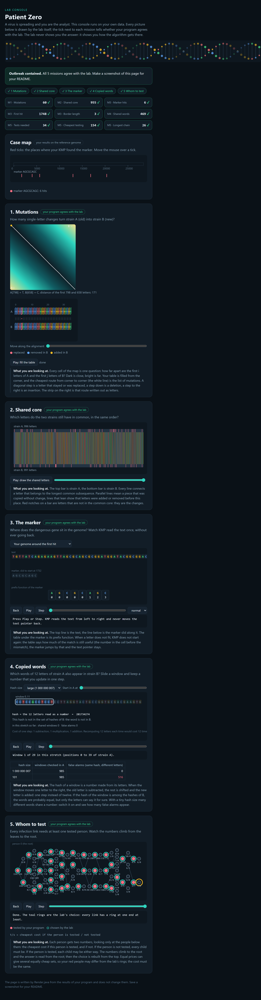

# Assignment 4. Patient Zero

Student ID: 253531  
Name: Abilmansur  
Group: SE2540

## Program output

Results of `java -cp out Main` on my personal data:

```text
Mutations: 60
Shared core: 955
Marker hits: 6
First hit: 1748
Border length: 3
Shared words: 469
Tests needed: 34
Cheapest testing: 154
Longest chain: 26
```

My outbreak report:



## Questions

### Mission 1. Edit distance

The cell d[i][j] stores the minimum number of operations needed to turn the first i letters of A into the first j letters of B. If the last letters match, I copy the diagonal value; otherwise, I add one to the minimum of the diagonal, upper and left cells, representing replacement, deletion and insertion. The initial values are d[i][0] = i and d[0][j] = j.

### Mission 2. Longest common subsequence

A subsequence keeps the order of letters but allows gaps, while a substring must be continuous. LCS can match letters at different positions in the two strains, so insertions and deletions do not prevent later letters from matching. This is why Shared core can be larger than the number of letters matching at exactly the same positions.

### Mission 3. Prefix function and KMP

The prefix function pi[i] gives the length of the longest proper prefix of the pattern ending at position i that is also its suffix. After a mismatch, KMP uses this information to change the pattern pointer without moving the text pointer backwards. My Border length is 3: the first three letters of my marker are also its last three letters, and no longer proper prefix matches its suffix.

### Mission 4. Rabin–Karp

Different words can have the same hash, so I compare their letters before counting a match. If many different windows have equal hashes, the algorithm performs more comparisons and can become much slower, reaching O(n*m*k) in the worst case for two strains of lengths n and m and window length k. My implementation stops checking candidates as soon as it finds a real match for a position in A.

### Mission 5. Tree DP

For each person v, dp[v][0] is the minimum cost in their subtree when v is not tested, and dp[v][1] is the minimum cost when v is tested. If v is not tested, every child must be tested; otherwise, I add the cheaper state of each child to the cost of testing v. Choosing the person with the most links is not always cheapest because it ignores testing costs: in a star, testing an expensive centre can cost more than testing all its cheap leaves.

## AI use

I used ChatGPT to review my implementation, check it against the assignment requirements, help with running the project. The review did not change my algorithm implementations.

## Timing (Mission 7)

Milliseconds, average of 3 runs, measured with `java -cp out Bench` on my computer.

| test | size | time |
|---|---|---|
| naive search | 20 000 / 40 000 / 80 000 | 124.6 / 231.7 / 408.1 ms |
| KMP | 20 000 / 40 000 / 80 000 | 6.2 / 4.1 / 0.7 ms |
| edit distance | 500 / 1000 / 2000 / 4000 | 11.8 / 17.5 / 47.4 / 182.5 ms |

With the pattern length fixed at 2000, the naive search grows approximately linearly with the text length in this benchmark. Edit distance is quadratic when both strains have the same length, so doubling their length should approximately quadruple the time; the increase from 2000 to 4000 is about 3.85 times. The decreasing KMP measurements reflect JVM warm-up, JIT compilation and measurement noise rather than a decreasing theoretical cost: KMP takes O(n + m) time.

## Complexity

For edit distance, LCS and shared words, n and m are the lengths of the two strains. For KMP, n is the text length and m is the pattern length. The window length is k, the number of people is v, and h is the number of marker hits.

| algorithm | time | space | assumptions |
|---|---|---|---|
| Edit distance | O(n*m) | O(n*m) | Full DP table |
| LCS | O(n*m) | O(n*m) | Full DP table |
| Prefix function and KMP | O(n + m) | O(m + h) | Includes the prefix array and returned hit positions |
| Rabin–Karp (shared words) | Expected O(n + m + n*k); worst O(n*m*k) | O(m) | Expected constant-time hash-map access; few false hash matches; letter verification costs up to O(k) per candidate |
| Tree DP and longest chain | O(v) | O(v) | Input is a tree; includes DP arrays, reconstruction and recursive traversal |

For shared words, k = 12 is fixed in this assignment, so the expected running time is O(n + m). The implementation stores starting positions of windows in B and updates each rolling hash in O(1).

## Validation

- `java tools/Check.java` passes all nine checks on tiny, small and dense.
- The HTML lab console shows green ticks for all nine results on my personal data.
- The minimum-cost testing set is reconstructed for the tree visualization.

## Before submission

- Include all four personal input files in `data/`.
- Include the screenshot at `output/outbreak.png`.
- Review the explanations and AI use statement.
- Push the completed project and report to `main`.
- Submit the public GitHub repository link in Moodle.